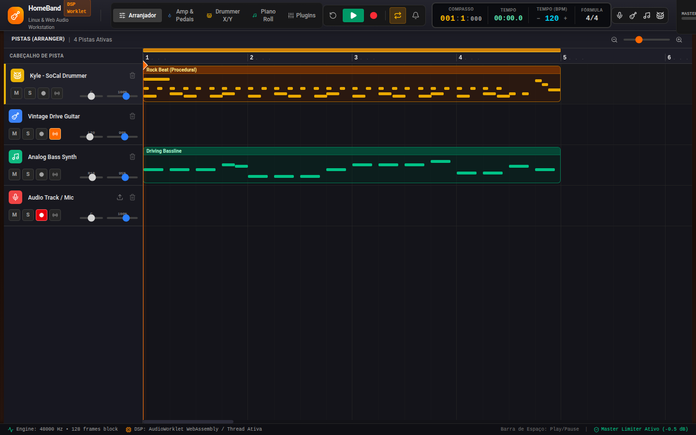
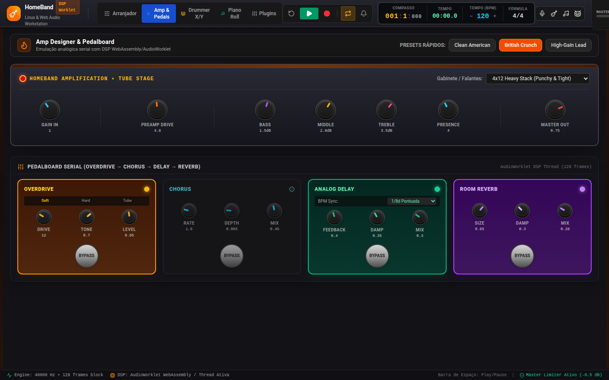
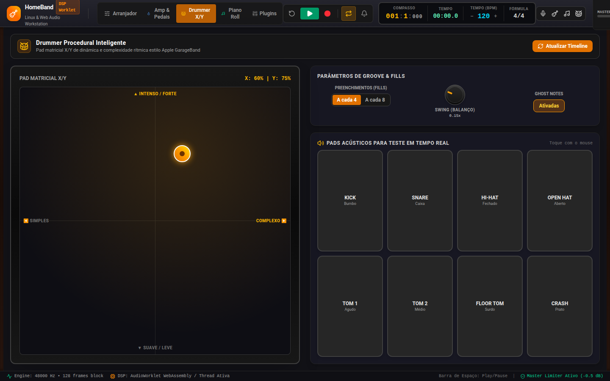

# HomeBand: Digital Audio Workstation for Linux & Web 🎸🥁🎹

[](https://opensource.org/licenses/MIT)
[](https://vuejs.org/)
[](https://www.rust-lang.org/)
[](https://tauri.app/)
[]()

**HomeBand** is a modern, high-performance, cross-platform Digital Audio Workstation (DAW) designed specifically for **Linux** and the modern **Web**. Inspired by the intuitive workflow and tactile design of Apple GarageBand, HomeBand combines a reactive **Vue 3 + Tailwind CSS** interface with a dedicated **Web Audio / AudioWorklet DSP** engine and a native **Rust backend (CPAL / ALSA / PipeWire / JACK)** packaged via **Tauri 2**.

---

## 📸 Screenshots

### 🎛️ Multitrack Arranger & Timeline


<p align="center">
  
  
</p>

---

## 🏛️ System Architecture

```
                       ┌──────────────────────────────────────────────┐
                       │     Reactive Frontend (Vue 3 + Pinia)        │
                       │   Timeline / Amp Designer / Drummer Pad      │
                       └──────────────────────┬───────────────────────┘
                                              │ Parameters & Transport
                                              ▼
                       ┌──────────────────────────────────────────────┐
                       │     AudioEngineManager (Singleton Core)      │
                       │  • Transport Clock (Lookahead Scheduler)     │
                       │  • Summing Bus & Master Limiter (-0.5 dB)    │
                       │  • Direct Monitoring & Buffer Decoder        │
                       └──────────────────────┬───────────────────────┘
                                              │ 128-frame blocks
                                              ▼
   ┌──────────────────────────────────────────────────────────────────────────────────┐
   │                    AudioWorklet Real-Time Thread (DSP)                           │
   ├──────────────────────┬────────────────────┬───────────────────┬──────────────────┤
   │ Overdrive Processor  │  Delay Processor   │  Chorus Processor │ Reverb Processor │
   │ (Tanh / Tube Asym)   │  (BPM Damped Tape) │  (Dual LFO Mod)   │ (Freeverb Comb)  │
   └──────────────────────┴────────────────────┴───────────────────┴──────────────────┘
                                              ▲
                                              │ IPC Bridge
                       ┌──────────────────────┴───────────────────────┐
                       │     Native Linux Engine (src-tauri in Rust)  │
                       │  • CPAL Audio I/O (ALSA / PipeWire / JACK)   │
                       │  • VST3, CLAP & LV2 Plugin System Scanner    │
                       │  • 32-bit Float Direct-to-Disk WAV Streaming │
                       └──────────────────────────────────────────────┘
```

### Digital Audio Architecture Highlights
- **Zero-Latency Audio Thread (AudioWorklet):** Audio DSP runs on a dedicated, high-priority real-time thread, processing in strict 128-sample frames without blocking the 60/120 fps GUI.
- **Sample-Accurate Lookahead Scheduler:** Eliminates JavaScript event-loop jitter by scanning ahead (40ms tick looking 120ms into the future) and scheduling metronome clicks, MIDI notes, and clip triggers directly on the audio context timeline.
- **Anti-Click / Anti-Zipper Smoothing:** All faders, panning, and filter cutoffs utilize target ramps (`setTargetAtTime` with 15–30ms time constants) to ensure artifact-free parameter adjustments.
- **Master Bus Limiter Protection:** Hardware and hearing protection via a brickwall dynamics compressor tuned with a hard knee and `-0.5 dBFS` threshold to prevent digital clipping.

---

## 🎛️ Core Features

### 1. Multitrack Timeline & Arranger
- **Interactive Musical Grid:** Continuous horizontal zooming (25px to 120px per beat) with bars, beats, and division subdivisions.
- **Audio Tracks:** Direct low-latency recording from USB audio interfaces and microphones (`navigator.mediaDevices.getUserMedia` in pure mode without destructive noise-gate filtering) and WAV/MP3 drag-and-drop file import with instant canvas waveform peak rendering.
- **MIDI & Virtual Instruments:** Polyphonic analog-style virtual synthesizer with resonant lowpass filtering and ADSR amplitude envelopes.
- **Channel Controls:** Mute (M), Solo (S), Record Enable (Arm), Real-Time Direct Monitoring toggle, volume fader, and stereo panning.
- **Retro LCD Transport Bar:** GarageBand-style LCD screen displaying `Bar : Beat : Ticks`, elapsed time, fine BPM adjustment, time signature (4/4), and loop/cycle region locators.

### 2. Amp Designer & Stompbox Pedalboard
Complete serial signal chain: `Input Gain -> Stompbox Pedalboard -> Preamp Saturation -> Tone Stack -> Cab Voicing -> Master Volume`.
- **Overdrive Stompbox:** Soft clipping (`Math.tanh`), hard clipping, and asymmetric tube saturation curves with dynamic 1st-order tone low-pass filtering.
- **Stereo Chorus Stompbox:** Dual-quadrature LFO modulation (90° phase shift between L and R for wide stereo imagery) with Rate, Depth, and Mix controls.
- **Analog Delay Stompbox:** Stereo circular delay line synchronized to BPM subdivisions (`1/4`, `1/8`, `1/8d`, `1/16`), feedback control, and high-frequency damping filter simulating vintage tape and bucket-brigade (BBD) warmth.
- **Ambient Reverb Stompbox:** Schroeder/Freeverb algorithm utilizing 4 parallel comb filters and 2 cascaded allpass diffusers.
- **Tube Amp Head & Cabinet Simulation:** Quick presets (*Clean American*, *British Crunch*, *High-Gain Lead*) with a 3-band tone stack (Bass, Middle, Treble), Presence, and multiple cabinet voicings (1x12 Vintage Alnico, 2x12 Open Back, 4x12 Heavy Stack).

### 3. Procedural "Drummer" Engine
- **2D Interactive X/Y Matrix Pad:**
  - **X-Axis (Simple ↔ Complex):** Dynamically adjusts groove density, shifts hi-hats between 8th and 16th notes, introduces offbeat kick syncopation, and adds snare ghost notes.
  - **Y-Axis (Soft ↔ Loud / Intense):** Dynamically alters velocity curves, triggers open hi-hat accents, and adds crash cymbal downbeats.
- **Automated Fills:** Generates drum fills every 4 or 8 bars with descending toms and snare rolls.
- **Synthesized Acoustic Drum Kit:** Pure DSP synthesis for Kick (exponential 140Hz → 42Hz pitch drop), Snare (body triangle + white noise snap), Hi-Hats (open/closed), High/Mid/Low Toms, and Crash cymbal.

### 4. Piano Roll & Smart Synthesizer
- **Musical Typing:** Play melodies directly from your computer keyboard using `A`, `W`, `S`, `E`, `D`, `F`, `T`, `G`, `Y`, `H`, `U`, `J`, `K` (C4 through C5).
- **Plug-and-Play USB MIDI:** Full Web MIDI API integration detecting connected MIDI controllers and keyboards.
- **Grid Snapping & Quantization:** One-click note alignment to 1/4, 1/8, or 1/16 grid divisions.

### 5. Native Linux Backend & Plugin System (Tauri 2 + Rust)
- **Linux Audio Engine:** Direct integration with ALSA, PipeWire, and JACK via Rust `cpal`.
- **Linux Plugin Scanner:** Scans standard system paths (`/usr/lib/vst3`, `~/.vst3`, `/usr/lib/clap`, `~/.clap`, `/usr/lib/lv2`, `~/.lv2`). Automatically detects installed suites like **Calf Studio Gear**, **DrumGizmo**, and native Linux VST3s.

---

## 📂 Project Structure

```
HomeBand/
├── public/
│   ├── favicon.svg
│   └── worklets/                      # AudioWorklet Processors (Audio Thread DSP)
│       ├── overdrive-processor.js
│       ├── delay-processor.js
│       ├── chorus-processor.js
│       └── reverb-processor.js
├── src/
│   ├── audio/                         # Web Audio Engine & Synthesizers
│   │   ├── AudioEngineManager.ts      # Singleton: Context, Clock, Routing & Lookahead Scheduler
│   │   ├── MasterBus.ts               # Summing Bus, Brickwall Limiter & Peak Metering
│   │   ├── TrackNode.ts               # Channel Strips (Volume, Pan, Mute, Solo)
│   │   ├── Metronome.ts               # Sample-accurate synthesized metronome click
│   │   ├── AudioRecorder.ts           # Direct Monitoring & AudioBuffer Capture
│   │   ├── DrumSynthesizer.ts         # Acoustic Drum Synthesis
│   │   └── SynthEngine.ts             # Virtual Polyphonic Synthesizer
│   ├── dsp/                           # DSP Math & Signal Processing
│   │   ├── DSPMath.ts                 # Waveshaping algorithms & waveform peak extraction
│   │   ├── AudioWorkletLoader.ts      # Safe AudioWorklet module registration
│   │   ├── Pedalboard.ts              # Serial Stompbox Chain
│   │   └── AmpDesigner.ts             # 3-Band Tone Stack & Cabinet Voicing
│   ├── stores/                        # Pinia State Management
│   │   ├── projectStore.ts            # Multitrack state, timeline, zoom, regions, transport
│   │   ├── audioStore.ts              # Master levels, VU metering, recording state
│   │   ├── ampStore.ts                # Amp parameters and pedalboard settings
│   │   └── drummerStore.ts            # X/Y pad matrix & procedural groove generator
│   ├── types/
│   │   └── audio.ts                   # Strict TypeScript definitions
│   ├── components/
│   │   ├── common/                    # RotaryKnob and VuMeter
│   │   ├── header/                    # AppHeader and TransportBar LCD
│   │   ├── timeline/                  # ArrangerTimeline, TrackHeader, AudioRegion, MidiRegion
│   │   ├── instruments/               # AmpPedalboard, DrummerPad, PianoRollModal
│   │   └── plugins/                   # PluginManagerModal (Linux VST3/CLAP/LV2 host view)
│   ├── App.vue                        # Root layout with vintage rosewood side panels
│   ├── main.ts                        # Application bootstrap
│   └── style.css                      # Tailwind CSS v4 styling
├── src-tauri/                         # Native Linux Desktop Backend (Rust / Tauri 2)
│   ├── Cargo.toml
│   ├── tauri.conf.json
│   ├── icons/
│   └── src/
│       ├── main.rs                    # Tauri IPC Handlers
│       ├── audio_engine.rs            # CPAL Audio I/O & Hound WAV exporter
│       └── plugin_scanner.rs          # Linux VST3, CLAP, and LV2 directory scanner
├── vite.config.ts
├── package.json
└── README.md
```

---

## 🚀 Getting Started

### Prerequisites
- **Node.js:** v18.0.0 or higher
- **Rust / Cargo:** (Required for native Linux desktop builds)
- **Linux Packages:** `libasound2-dev`, `libwebkit2gtk-4.1-dev`, `pkg-config`

### Development Server (Browser / PWA)
```bash
# Clone the repository
git clone https://github.com/marcellopato/HomeBand.git
cd HomeBand

# Install dependencies
npm install

# Start development server
npm run dev
```
Open **`http://localhost:5180`** in your browser (Chrome, Brave, Firefox, Edge).

### Build for Web Production
```bash
npm run build
npm run preview
```

### Build Native Linux Desktop App (.deb / AppImage)
```bash
# Compile web bundle and package with Tauri
npm run build
cd src-tauri && cargo build --release
```

---

## ⌨️ Keyboard Shortcuts
- **Spacebar:** Play / Pause transport
- **Keys A, W, S, E, D, F, T, G, Y, H, U, J, K:** Musical typing on the Piano Roll (C4 to C5)
- **Double Click (Any Knob):** Reset parameter to default value

---

## 🤝 Community & Contributing

HomeBand is an open-source project and we enthusiastically welcome contributions from musicians, audio engineers, DSP researchers, Rust programmers, and frontend developers!

### How You Can Help
1. **Audio DSP & Synthesis:** Implement new effect pedals (Phaser, Flanger, Compressor, Tape Echo), add new impulse responses (IRs) for cabinets, or enhance acoustic drum synthesis models.
2. **Native Linux Plugin Hosting:** Extend the Rust backend in `src-tauri` using `nih-plug` or `clasp` to instantiate and host `.vst3` and `.clap` plugin windows directly on Wayland/X11.
3. **MIDI & Sequencing:** Add automation curves (volume, pan, filter cutoff over time), MIDI file export/import (.mid), and controller mapping (MIDI Learn).
4. **UI/UX & Accessibility:** Polish controls, improve responsiveness, create themes, or translate documentation into additional languages.

### Contribution Workflow
1. **Fork the Repository:** Click the **Fork** button at the top of [github.com/marcellopato/HomeBand](https://github.com/marcellopato/HomeBand).
2. **Create a Feature Branch:**
   ```bash
   git checkout -b feature/amazing-new-dsp-effect
   ```
3. **Commit Your Changes:**
   ```bash
   git commit -m "feat(dsp): add tape saturation algorithm with oversampling"
   ```
4. **Push to Your Branch:**
   ```bash
   git push origin feature/amazing-new-dsp-effect
   ```
5. **Open a Pull Request:** Describe the changes, motivations, and any relevant audio test recordings.

### Reporting Issues & Feature Requests
Encountered a bug or have an idea for a killer feature?
Open an issue on GitHub: [https://github.com/marcellopato/HomeBand/issues](https://github.com/marcellopato/HomeBand/issues)

---

## 📄 License
This project is open-source and released under the **[MIT License](LICENSE)**.

Developed by **[marcellopato](https://github.com/marcellopato)** and the open-source audio community.
